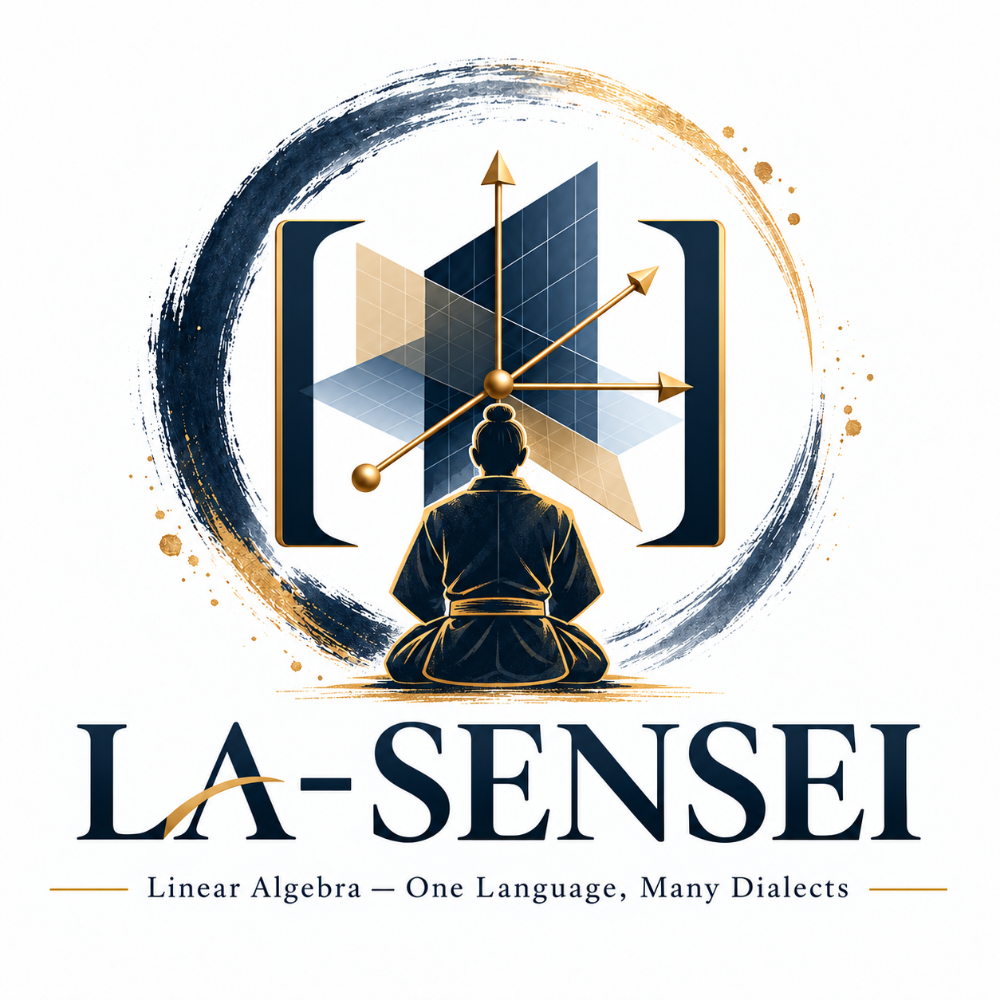

# LA-SENSEI


<p align="center">
  
</p>

<h1 align="center">LA-SENSEI</h1>
<p align="center"><em>Linear Algebra — One Language, Many Dialects</em></p>

### Linear Algebra — Structural Experiments, Not Standard Exercises, Illustrated

**Companion repository for *Linear Algebra: One Language, Many Dialects***  
*Higher Math for the Impatient* · HoloMathics, LLC · **prepublication working edition**

> What changes when you change the scalars? What stays invariant? Exactly which hypothesis did your favorite theorem require?

This is **not** a second undergraduate linear algebra course and not a dump of unrelated notebooks. It follows the **69 numbered exercises in the October 2026 manuscript**, plus **six extended mathematical laboratories**. Finite fields, modules, tensors, forms, symmetry, arithmetic over rings, tropical products, coding and operator stability each speak a different dialect of the same structural language.

## Start in two minutes

Requires **Python 3.10+**. The executable core uses the Python standard library; no SageMath or NumPy needed.

```bash
python -m venv .venv
source .venv/bin/activate          # Windows PowerShell: .venv\Scripts\Activate.ps1
python -m pip install -e '.[test]'
la-sensei list
la-sensei lab passports
la-sensei chapter 2
python -m pytest -q
```

For the interactive notebooks:

```bash
python -m pip install -e '.[lab,test]'
jupyter lab
```

Run notebooks from the repo root so the editable package is importable. No external datasets or network calls are required.

## Choose your route

| Reader goal | Start here |
|---|---|
| Follow the manuscript in order | [`EXERCISE_MAP.md`](EXERCISE_MAP.md) and [`exercises/`](exercises/) |
| Discover the six structural bridges | [`labs/`](labs/) and [`notebooks/`](notebooks/) |
| Enter through finite fields | [`exercises/ch02.md`](exercises/ch02.md), `la-sensei chapter 2` |
| Study eigenvalues after scalar extension | [`labs/02_three_passports.md`](labs/02_three_passports.md), `la-sensei lab passports` |
| Decode by finite geometry | [`labs/03_hamming.md`](labs/03_hamming.md), `la-sensei lab hamming` |
| Compare matrix classifications | [`labs/04_similarity.md`](labs/04_similarity.md), `la-sensei lab similarity` |
| Find arithmetic invisible over Q | [`labs/05_torsion.md`](labs/05_torsion.md), `la-sensei lab torsion` |
| Explore nonnormal growth | [`labs/06_transients.md`](labs/06_transients.md), `la-sensei lab transients` |

## What is actually covered?

- **All 69 original chapter exercises** are indexed and faithfully transcribed into 14 worksheets, with their original chapter/exercise numbering.
- **32 exercises** have directly executable worked instances; **2 additional exercises** have partial computational checks. The remaining **35** are explicitly identified as proof, conceptual, or exploratory work. This distinction is deliberate: checking examples is **not a proof**.
- **All six extended book laboratories** have executable cores, guided Markdown notes, and Jupyter notebooks.
- **Tests** check arithmetic axioms, Fano incidence, Hamming distance and decoding, polynomial minimality, Smith invariants, and cross-dialect phenomena.

This is an **initial companion**, not a claim that all theorems, all exercise solutions, or all advanced constructions are computer-verified. See [Scope and limitations](docs/SCOPE.md).

## The six laboratories

| Book lab | Experiment | Central invariant |
|---|---|---|
| I | Seven points make a universe | Dependence and incidence |
| II | One matrix, three passports | Characteristic and minimal polynomials |
| III | Repair seven-bit messages | Syndrome, rank, minimum distance |
| IV | Equal characteristic polynomials, unequal operators | Minimal polynomial and rank of p(A) |
| V | Arithmetic information rationals erase | Smith invariants and torsion |
| VI | Eigenvalues miss transient instability | Norm of powers, nonnormality |

## Compare the dialects

```python
from lasensei.finite import F2, F4
from lasensei.linear import power, eye
A = [[0,1],[1,1]]
assert power(A, 3, F2) == eye(2)
assert all(F2.add(F2.add(F2.mul(x,x),x),1) != 0 for x in range(2))
assert [x for x in range(4) if F4.add(F4.add(F4.mul(x,x),x),1)==0] == [2,3]
```

The matrix has no eigenvalues in **F₂**, and two distinct eigenvalues after extending scalars to **F₄**. The characteristic polynomial has not changed. The available roots have.

## Repository layout

```text
LA-SENSEI/
├── README.md, EXERCISE_MAP.md, pyproject.toml
├── exercises/                   14 manuscript-mapped worksheets + index.json
├── labs/                        6 guided extended laboratories
├── notebooks/                   6 executable .ipynb laboratories
├── src/lasensei/
│   ├── finite.py                finite prime and extension fields
│   ├── linear.py                exact finite-field matrix algorithms
│   ├── geometry.py              Fano plane, Hamming and Reed–Solomon
│   ├── tensors.py               exterior and Plücker computations
│   ├── symmetry.py              GL(2,F₂) and modular representations
│   ├── advanced.py              forms, Clifford and Lie examples
│   ├── rings.py                 2x2 Smith invariants, integer boundaries
│   ├── tropical.py              semiring matrix operations and routes
│   ├── numerical.py             nonnormal transient operator norms
│   ├── chapter_demos.py         computational examples for all chapters
│   └── lab_registry.py          6 book-aligned experiments
├── tests/                       automated mathematical checks
└── docs/                        conventions, limits, development notes
```

## A note on the name

**LA-SENSEI** is our working title. *SENSEI* signals a guided mathematical apprenticeship: not a solver that hides the answer, but a guide that makes structural differences visible. The underlying project does not depend on the name; it can be renamed before publication.

## Attribution and publication status

Companion to *Linear Algebra: One Language, Many Dialects*, part of **Higher Math for the Impatient**. Manuscript and companion are **under development**, not yet announced as released editions. **HoloMathics, LLC** · mirco@holomathics.com.

Copyright © 2026 HoloMathics, LLC. **All rights reserved pending an explicit publication/licensing decision.** This does not license or republish the booklet. The exercise statements here are provided solely as a navigation map to the author's working manuscript.
